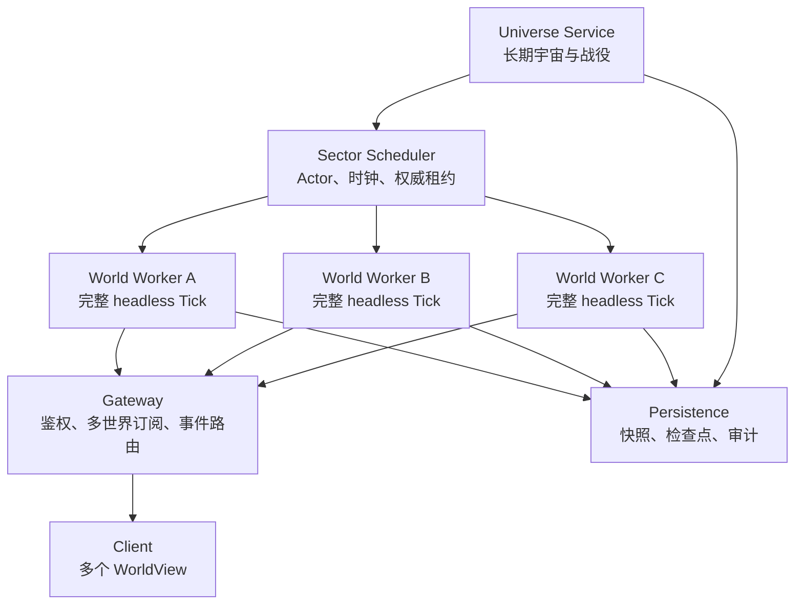

# 总体架构

## 产品边界

BetterMindustry 是持久宇宙模拟器与多世界实时客户端的组合：

- 无玩家 Sector 继续完整固定 Tick。
- 有玩家或正在被观察的 Sector 增加渲染与网络订阅。
- 一个客户端可以同时维护多个 `WorldView`。
- 长期宇宙显式组织为 `Universe / Solar System / Planet / Sector`。

这不是单纯修改原版客户端或叠加模组。权威模拟、画面订阅和长期宇宙状态必须分层。

## 运行时拓扑



### Universe Service

维护长期战役，不直接执行地图 Tick：

- Universe、Solar System、Planet、Sector 的实例层级。
- 队伍、归属、战争、区块可见性和战役结果。
- 全局因果时钟。
- Sector Actor 注册、权威租约和跨 Sector 事件。
- 世界目录、玩家 Focus Sector 和订阅权限。

### World Worker

维护一个权威 Sector 的完整运行状态：

- Tile、建筑、单位、子弹和效果状态。
- 电力、物流、资源、波次和 AI。
- 逻辑处理器。
- 固定 Tick、随机种子和检查点。
- 世界事件与跨 Sector 消息。

第一阶段一个 Worker 进程承载一个 Sector。这样可直接隔离 Mindustry 的 `Vars.world`、`Vars.state`、`Groups` 等全局单例。

### Gateway

对客户端提供单一入口并复用底层 World Worker：

- 登录、身份和权限。
- `FocusSector` 控制权。
- 多个 Sector 的画面订阅。
- 快照按 `sectorId` 路由。
- 跨 Sector 传送和观察切换。
- 订阅频率、优先级和断线重连。

### Client

同时维护多个可视化世界，但只有一个 Focus Sector 接收玩家控制。其他已订阅 Sector 可以完整渲染、缩略显示或只显示统计。

客户端共享：

- 内容定义、贴图、字体、音频和 Shader。
- GPU 设备与全局设置。

客户端按 WorldView 独立维护：

- `GameState`
- `World`
- 实体组
- 相机、选择和 UI 绑定
- 静态地形缓存
- 网络订阅和包队列

## Game Tick 与 Render Tick

长期架构必须把权威游戏更新和画面更新分开：

```text
Game Tick Process (authoritative)
  固定 Tick
  资源、单位、建筑、电力、波次、逻辑
  输出 tick snapshot / delta
          |
          v
Render Tick Process (non-authoritative)
  可变帧率
  插值、相机、粒子、光照、UI
  不修改库存、位置、战斗结果
```

Game Tick 与 Render Tick 的时钟不同：

- Game Tick 使用固定模拟步长，允许加速追赶，但禁止跳过状态提交。
- Render Tick 使用现实帧率，只负责插值和表现。
- Render Tick 卡顿不能回写或暂停 Game Tick。
- Game Tick 的结果必须通过带 `sectorId` 和 `tick` 的快照/增量传给渲染侧。

当前调试器已经通过 SSE 提供 `bettermindustry.render.v1` 只读帧，浏览器使用自己的
`requestAnimationFrame` 渲染循环。当前帧只包含 Tick 和实体统计，不包含完整地图几何；
Render Tick 独立桌面进程和完整场景订阅仍在下一阶段。

## 模拟原则

### 玩家不是模拟开关

玩家离开 Sector 后，该 Sector 默认继续运行完整固定 Tick，只关闭：

- 渲染。
- 音频和粒子表现。
- 普通玩家高频快照。
- 镜头与输入插值。

不允许自动把精确世界切换成“平均产量乘时间”的账本模型。

### 固定 Tick

正常、加速和恢复路径都按固定 Tick 推进：

```text
process sector inbox at tick boundary
run one exact simulation tick
commit cross-sector events
record metrics and audit data
```

加速表示每个现实秒执行更多 Tick，而不是扩大 `delta` 或跳过 Tick。

如果资源不足，应当报告模拟落后或降低加速倍率，不能静默降低精度。

### 模拟状态

| 状态 | 行为 |
| --- | --- |
| `RUNNING_REALTIME` | 完整模拟，正常游戏速度 |
| `RUNNING_ACCELERATED` | 完整模拟，加速追赶 |
| `SUSPENDED` | 明确暂停，保留检查点 |
| `FAILED` | 停止并保留故障现场 |

`SUSPENDED` 不是“无玩家”的默认状态，只用于明确暂停、战役结束或资源保护。

## 多视口客户端

### MVP：顺序场景绑定

Mindustry 当前大量依赖全局状态。第一版不立即重构全部代码，而是在客户端主线程顺序绑定 WorldView：

```java
try (var scope = view.bind()) {
    applyQueuedPackets(view);
    render(view);
}
```

绑定范围至少包括：

- `Vars.state`
- `Vars.world`
- `Vars.player`
- `Groups` 中各实体组
- 世界相机
- World 对应的渲染缓存

网络 I/O 可以在其他线程执行，但只能把带 `sectorId` 的包放入场景队列。主线程绑定场景后再应用。

长期必须把全局状态迁移到真正可实例化的 `GameContext`，参见 ADR-0002。

### 渲染

每个视口独立渲染到窗口区域或离屏 framebuffer，最后统一合成：

- 静态地形按 Tile chunk 烘焙。
- Tile 变化只更新受影响 chunk。
- 每个相机独立裁剪。
- 建筑、单位和特效动态绘制。
- 小视口可以降低刷新率和细节等级。

第一版限制完整视口数量，其他 Sector 使用缩略图、低频刷新或统计视图。

### 无缝边界

原版 Sector 是独立生成的方形地图，默认不等同于连续大世界。

第一阶段支持多个独立视口，不承诺镜头无缝跨越 Sector。若以后需要无缝地图，必须额外引入：

- 相邻 Sector 地形边界约束。
- 连续坐标空间。
- 跨边界实体迁移。
- 双方 Tick 协调。
- 边界建筑和物流协议。

## 宇宙领域模型

### 内容定义与战场实例分离

```text
ContentCatalog
  ├─ PlanetDefinition
  └─ SectorDefinition

CampaignUniverse
  ├─ UniverseState
  ├─ SolarSystemState
  │    └─ PlanetState
  │         └─ SectorState
  │              ├─ ownership
  │              ├─ gameClock
  │              ├─ checkpoint
  │              └─ eventOutbox
  └─ SectorActor topology
```

原版 `Planet` 和 `Sector` 继续作为内容与兼容层。长期服务器动态状态不能全部堆回 `SectorInfo`。

稳定地址示例：

```text
universe-7/solar-system-1/serpulo/sector-170
```

稳定 ID 用于存档、网络路由和审计，不依赖数组下标。

## 跨 Sector 事件

发射台、传送、增援和战役命令使用事件总线。

事件至少包含：

- 全局唯一 `eventId`。
- `sourceSectorId` 和 `targetSectorId`。
- 来源 Tick 和计划生效 Tick。
- 玩家或队伍归属。
- 幂等处理信息。
- 超时、补偿与审计状态。

目标 Actor 必须在 Tick 边界接收事件。重复事件不得重复发放资源。

### 物流优先级

发射台目标可以提升订阅优先级：

- 玩家已订阅时，完整渲染降落过程。
- 有玩家但未订阅时，提高快照频率。
- 无玩家时，保持精确模拟并按正常检查点记录。
- 不自动把所有接收地图加载到所有客户端。

## Sector 兴趣等级

| 等级 | 典型状态 | 网络与渲染 |
| --- | --- | --- |
| P0 | 玩家控制、战斗、被观察 | 高帧率、完整渲染 |
| P1 | 有玩家或重要跨图事件 | 完整或降级渲染 |
| P2 | 无玩家、持续生产 | 不发画面，完整模拟 |
| P3 | 明确暂停或战役外 | 检查点，不 Tick |

兴趣等级首先影响网络和渲染优先级，不擅自改变模拟精度。

## 并发与确定性

- 不同 Sector 可以并行。
- 单个 Sector 内保持确定的 Tick 顺序。
- 跨 Sector 消息只允许在 Tick 边界提交。
- 线程分配由 Actor 调度器决定，不在每个 Tick 随机决定。
- 生产、战斗和物流测试必须验证相同种子、相同命令和相同 Tick 数得到相同结果。
- 渲染帧率与模拟 Tick 解耦，但渲染侧的插值和预测不得成为权威状态。

## 视觉增强

Mindustry 是二维俯视渲染。所谓“2.5D 光影”包括动态光照、阴影、环境光遮蔽、法线/材质响应和 Bloom。

视觉功能要在模拟和网络稳定后加入，并提供关闭、低、中、高配置。

## 安全边界

- 所有资源、移动和战斗结果由权威 Sector Actor 裁决。
- 控制 API 与玩家协议分离。
- 玩家不能直接构造任意跨 Sector 事件。
- 世界进程只接受受控控制通道。
- 每个 Sector 有独立资源、Tick 和网络预算。
- 管理操作必须审计。
